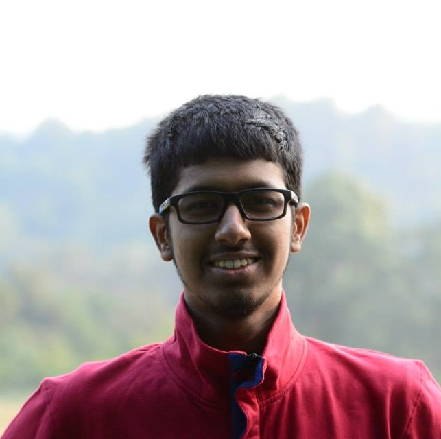

---
# Feel free to add content and custom Front Matter to this file.
# To modify the layout, see https://jekyllrb.com/docs/themes/#overriding-theme-defaults

layout: home
title: About Me
---

{:height="250px" width="250px"}

### **Education** ###
1. B.Tech. in Electrical Engineering 
Indian Institute of Technology Bombay (Mumbai, India)
2. PhD in Electrical Engineering 
Stanford University (California, USA)

My current research is on secure distributed systems and cryptography with applications to blockchain protocols.

I'm currently a postdoctoral scholar at UC Berkeley working with [Prof. Sanjam Garg](https://people.eecs.berkeley.edu/~sanjamg/). Before that, I was a senior researcher at [Babylon](https://babylonlabs.io/).
I obtained my PhD from Stanford University advised by [Prof. David Tse](https://tselab.stanford.edu/). I have previously done internships with [Mysten Labs](https://mystenlabs.com/), [Protocol Labs](https://protocol.ai/), and [Subspace Labs](https://subspace.network/).

Please look at my [projects](/projects) to know about my research and publications.

I am also a violinist and singer in the Carnatic (south Indian) classical style of music. I am an ardent fan of Indian classical music and I'm committed to preserving and popularizing this art.  
[Youtube link to my performances](https://www.youtube.com/playlist?list=PLOqYw2iE3KdzhvCYeVnATlJJZ3kfY6p_X)
